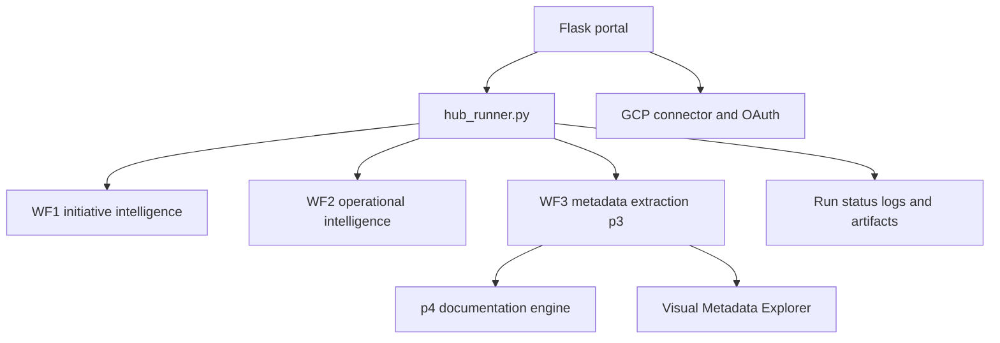

# Enterprise Data Intelligence Hub | AI for BI

**Original application architecture · POC in development**

[Launch original portal interface](https://desmondjialiangloh.github.io/hub-portal.html) · [Architecture](docs/architecture.md)

AI for BI supports engineering asset discovery, reuse, metadata understanding and documentation, rather than generative business insights.

## Original implementation

| Module | Contribution |
|---|---|
| [app.py](original/app.py) | Portal and execution API |
| [hub_runner.py](original/hub_runner.py) | Notebook configuration and subprocess orchestration |
| [Notebooks](original/original_notebooks/) | Four engines supporting three workflows |
| [visual_explorer.py](original/visual_explorer.py) | Metadata visualization and logical relationships |
| [gcp_connector.py](original/gcp_connector.py) | BigQuery metadata discovery and candidate SQL references |
| [gcp_oauth.py](original/gcp_oauth.py) | OAuth integration |

Personal contributions: solution conceptualization, architecture, application development, workflow integration, metadata engineering and documentation automation.

## Run locally

See [original operating guide](original/README.md). From `original/`, create a virtual environment, install `requirements.txt`, then run `python app.py`. Supply your own authorized Tableau/GCP configuration and inputs. Never expose this trusted-local POC directly to the internet.

## Public demonstration

Original HTML templates adapted to static replay. The Metadata Explorer is generated by the original Python generator using synthetic metadata. Workflow outputs and GCP authentication are illustrative; no actual notebook execution or cloud calls occur. Dataform and scheduled-query adapters are pending. Candidate lineage is not verified physical lineage.

Original notebook outputs, runtime caches, historical inputs and run artifacts are excluded. Selected enterprise defaults are replaced. Source review is not a formal security audit. Existing V3/V4 reference demos remain available in the repository.
