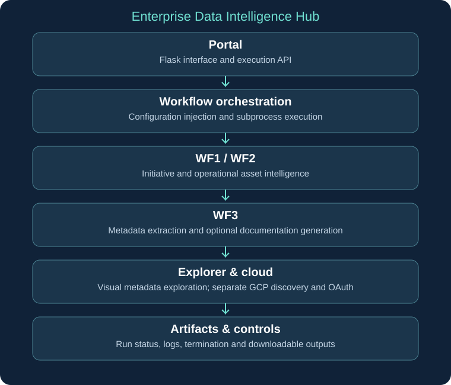

# Enterprise Data Intelligence Hub

**Proof of concept in development** · Professional engineering portfolio

## Architecture

This is a generalized reconstruction, not an internal deployment diagram.

## Technical capabilities and personal contributions

- **Solution architecture:** Designed a consolidated metadata-driven BI engineering portal.
- **Workflow integration:** Integrated notebook engines with configuration-driven execution.
- **Metadata engineering:** Developed extraction, logical field resolution and documentation workflows.
- **Visual exploration:** Integrated metadata relationship exploration.
- **Cloud integration:** Integrated GCP metadata discovery and OAuth components.
- **Execution management:** Implemented status, logs, termination and artifact access.

## Implementation boundaries

POC, not a production multi-user service. Authentication, CSRF protection, rate limits, concurrency isolation and upload controls require further work. Live-system accuracy, complete lineage and enterprise deployment are not independently verified.

## Explore

- [Architecture walkthrough](docs/architecture.md)
- [Executive case study](docs/case-study.pdf)
- [Technical design](docs/technical-design.md)
- [Showcase slides](docs/showcase.pptx)
- [Interactive illustrative walkthrough](https://desmondjialiangloh.github.io/enterprise-data-intelligence-hub.html)

Original enterprise implementation, confidential data and credentials are excluded from this reference edition.

## V3 executable reference demonstration

Run `python demo/hub.py` and `python -m unittest discover -s demo -v` from the repository root. [Source](demo/hub.py) · [Generated results](demo/results.json). This newly authored synthetic reference is distinct from the original enterprise implementation; it does not establish historical production performance.

## V4 interactive portal

[Launch the browser-based fictional asset search and metadata explorer](https://desmondjialiangloh.github.io/hub-portal.html). No enterprise connections or credentials.

