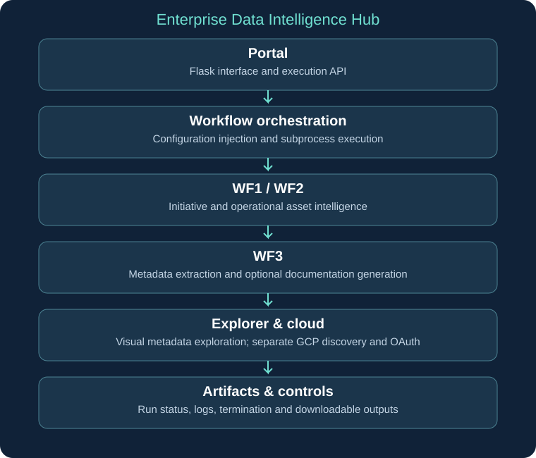

# Enterprise Data Intelligence Hub: conceptual architecture

## 1. Portal
Flask interface and execution API.

## 2. Workflow orchestration
Configuration injection and subprocess execution.

## 3. WF1 / WF2
Initiative and operational asset intelligence.

## 4. WF3
Metadata extraction and optional documentation generation.

## 5. Explorer & cloud
Visual metadata exploration; separate GCP discovery and OAuth.

## 6. Artifacts & controls
Run status, logs, termination and downloadable outputs.

## Boundaries
POC, not a production multi-user service. Authentication, CSRF protection, rate limits, concurrency isolation and upload controls require further work. Live-system accuracy, complete lineage and enterprise deployment are not independently verified.
